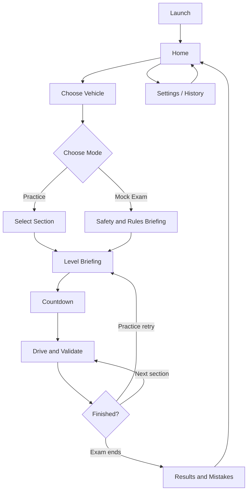

# 03 — App / Game Flow

## Main user journey
Launch → Home → Vehicle selection → Practice or Mock Exam → Section / Briefing → Countdown → Drive → Feedback / Results → Retry, Next or Home.

## Screen contracts
- Home: Play, Progress, Settings, Quit.
- Vehicle selection: car / motorcycle / scooter, continue/back.
- Mode: Practice, Mock Exam.
- Practice: section selector, brief instructions, retry.
- Mock exam: applicable rules and safety briefing, start confirmation.
- Gameplay HUD: speed, gear, score, steering, throttle, brake, pause, camera, signals as required.
- Pause: Resume, Restart, Quit with confirmation.
- Results: pass/fail, score, deductions, violation details, retry, home.

## State rules
One continuous rule violation triggers one deduction until cleared. Pause freezes simulation and timer safely. A mock-exam instant failure cannot be undone inside the same run. Save completed attempts and meaningful checkpoints only; no accidental progress loss on back navigation.
